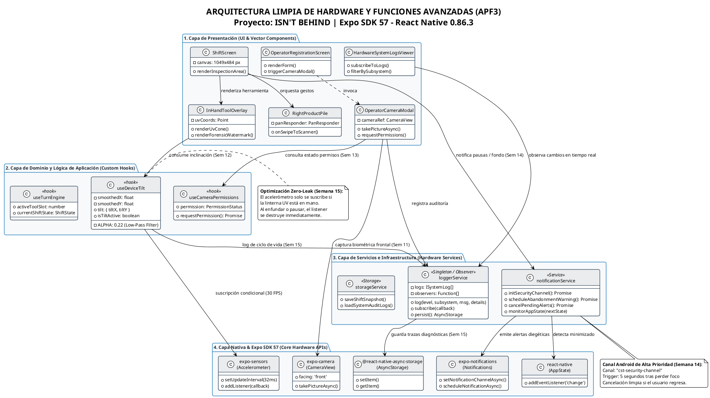

# GUÍA MAESTRA DE DIAPOSITIVAS (PPT) Y GUION DE SUSTENTACIÓN
## AVANCE DE PROYECTO FINAL 03 (APF3) — UNIDAD 3
> **Curso:** Desarrollo de Aplicaciones Móviles (100000ST91)  
> **Proyecto:** ISN'T BEHIND  
> **Unidad 3:** Gestión del hardware y funciones avanzadas de aplicaciones móviles (Semanas 11, 12, 13, 14, 15)  
> **Modalidad:** Exposición oral presencial/virtual con diapositivas (PowerPoint) y demostración en dispositivo móvil.

---

### ÍNDICE DE DIAPOSITIVAS

1. **Diapositiva 1:** Portada, Identificación y Objetivos de la Unidad 3.
2. **Diapositiva 2:** Semanas 11 y 13 — Acceso a Cámara Frontal y Flujo Formal de Permisos (`expo-camera`).
3. **Diapositiva 3:** Semana 12 — Acceso a Sensores del Dispositivo: Acelerómetro e Inclinación Cinemática (`expo-sensors`).
4. **Diapositiva 4:** Semana 14 — Notificaciones Push y Notificaciones Locales Diegéticas (`expo-notifications`).
5. **Diapositiva 5:** Semana 15 — Mejores Prácticas de Rendimiento, Optimización y Bus Centralizado de Logging (`loggerService`).
6. **Diapositiva 6:** Arquitectura y Experiencia de Juego — Pila Física, Deslizamiento al Escáner y PC Usable.
7. **Diapositiva 7:** Conclusiones, Leyes de Ingeniería y Matriz de Cumplimiento del Sílabo.

---

## DIAPOSITIVA 1: PORTADA, OBJETIVOS Y ARQUITECTURA LIMPIA DE HARDWARE

### Título / Subtítulo
- **Título Principal:** ISN'T BEHIND: INTEGRACIÓN DE HARDWARE NATIVO Y FUNCIONES AVANZADAS
- **Subtítulo:** Avance de Proyecto Final 03 (APF3) — Unidad 3: Semanas 11 a 15
- **Datos Académicos:** Universidad Tecnológica del Perú (UTP) | Curso: Desarrollo de Aplicaciones Móviles (100000ST91)

### Contenido de la Diapositiva (Texto y Viñetas para la PPT)
- **Objetivo General:**
  - Diseñar e implementar una arquitectura limpia en React Native (Expo SDK 57 / RN 0.86.3) que orqueste los periféricos y sensores físicos del teléfono móvil como mecánicas diegéticas de un videojuego de inspección aduanera.
- **Objetivos Específicos de la Unidad 3 (Alineados al Sílabo UTP):**
  - **Semana 11 (Cámara):** Integrar la captura de video y fotografía en tiempo real mediante `expo-camera` para la emisión del carnet biométrico del operario.
  - **Semana 12 (Sensores Físicos):** Implementar la lectura continua del acelerómetro del dispositivo con `expo-sensors` y un filtro de inercia cinemática para dirigir el haz de la linterna ultravioleta.
  - **Semana 13 (Gestión de Permisos en Runtime):** Aplicar el patrón de solicitud asíncrona de permisos de hardware en tiempo de ejecución, gestionando los estados concedido, denegado y reintentos institucionales.
  - **Semana 14 (Notificaciones Push y Locales):** Desarrollar un servicio autónomo con `expo-notifications`, creando canales de alta prioridad en Android y vinculándolos al ciclo de vida (`AppState`) para advertir el abandono de puesto en segundo plano.
  - **Semana 15 (Optimización y Logging):** Establecer políticas de recolección de memoria (Zero-Leak) en la destrucción de listeners de hardware, acopladas a un bus de auditoría en vivo (`loggerService`) y persistencia en `AsyncStorage`.
- **Arquitectura de Software:**
  - Separación estricta en 4 capas: Presentación (UI/Gestos), Dominio (Hooks cinemáticos), Servicios de Infraestructura (Patrón Observer) y Módulos Nativos de Expo.
- **Stack Tecnológico:**
  - Expo SDK 57, React Native 0.86.3, TypeScript 5.x Strict, Vector Art SVG/Canvas nativo.

---

### Código del Diagrama de Arquitectura en PlantUML



---

### Guion de Exposición Detallado (Diapositiva 1)

#### 1. Explicación del Contenido y Viñetas (Objetivos de la Unidad 3)
> *"Buenos días estimado docente y compañeros. El día de hoy nos complace sustentar el Avance de Proyecto Final 03 de nuestra aplicación móvil ISN'T BEHIND, correspondiente de manera íntegra a la Unidad 3: 'Gestión del hardware y funciones avanzadas de aplicaciones móviles'.*
> 
> *El objetivo central de este avance ha sido trascender el uso común de los periféricos del celular. En lugar de agregar botones aislados de prueba, integramos la cámara frontal, el acelerómetro, el ciclo de permisos, las notificaciones locales y el almacenamiento de auditoría como componentes indispensables de la narrativa y la jugabilidad de inspección aduanera.*
> 
> *Como pueden apreciar en los objetivos de la diapositiva, el proyecto cubre el 100% de los temas fijados en el sílabo desde la Semana 11 hasta la Semana 15:*
> - *En las Semanas 11 y 13 cubrimos el acceso a la cámara frontal y la solicitud formal de permisos en tiempo de ejecución para el registro biométrico del operario.*
> - *En la Semana 12 vinculamos los sensores de movimiento físico para manipular la linterna ultravioleta.*
> - *En la Semana 14 orquestamos notificaciones locales que sancionan disciplinariamente al jugador si desatiende la terminal en segundo plano.*
> - *Y en la Semana 15 implementamos una política estricta de eficiencia energética con destrucción de suscripciones para evitar memory leaks, junto a un bus de logging persistente en almacenamiento local."*

#### 2. Explicación del Bloque de Arquitectura en PlantUML
> *"Para que todas estas funcionalidades de hardware convivan sin comprometer la estabilidad del sistema, diseñamos una Arquitectura Limpia desacoplada en cuatro capas bien diferenciadas, tal como se ilustra en el diagrama de arquitectura:*
> 
> *1. En la primera capa, la Capa de Presentación, residen nuestras pantallas vectoriales y modales, tales como el modal de la cámara biométrica, la mesa de trabajo en canvas apaisado de 1049 por 484 píxeles y la consola de auditoría.*
> 
> *2. En la segunda capa, la Capa de Dominio, se encuentran los Custom Hooks encargados de la lógica reactiva. Destaca el hook `useDeviceTilt`, el cual no solo lee los ejes espaciales del acelerómetro, sino que implementa un filtro de paso bajo con factor alfa de 0.22. Esto dota al haz de luz de una inercia cinemática que estabiliza el movimiento y simula con fidelidad el peso de una linterna en la mano del operario.*
> 
> *3. En la tercera capa, la Capa de Infraestructura y Servicios, implementamos dos servicios clave mediante patrones de diseño: el `notificationService`, que administra el canal nativo de Android y escucha los cambios de estado de la aplicación mediante `AppState`; y el `loggerService`, estructurado bajo el patrón Observer. Este servicio actúa como una caja negra de avión: captura cualquier evento crítico emitido por la cámara o los sensores y notifica a las vistas suscritas.*
> 
> *4. Finalmente, en la cuarta capa se ubican las librerías nativas del SDK 57 de Expo: `expo-camera`, `expo-sensors`, `expo-notifications` y `AsyncStorage`. Esta separación garantiza que la interfaz de usuario nunca invoque directamente el hardware de bajo nivel, asegurando un mantenimiento sencillo y permitiendo que ninguna clase o componente de nuestro repositorio supere las 300 líneas de código."*

#### 3. Explicación de las Imágenes y Diagramas
> *"El diagrama que observan en pantalla sintetiza cómo fluye la información entre el usuario y los componentes de hardware del teléfono. Observen cómo la flecha que une el modal de registro con la cámara frontal atraviesa primero la verificación de permisos en tiempo de ejecución; si el permiso es concedido, recién se activa el componente nativo de captura.*
> 
> *De igual manera, el cono de luz UV y la pila de productos interactúan con la mesa de trabajo sin recargar el hilo principal de renderizado, gracias al uso coordinado de hooks cinemáticos y listeners condicionales. Durante las siguientes diapositivas, veremos cómo este modelo conceptual se traduce en código fuente limpio y en capturas reales del juego ejecutándose en un dispositivo Android físico."*

---

## DIAPOSITIVA 2: SEMANAS 11 Y 13 — CÁMARA FRONTAL Y FLUJO FORMAL DE PERMISOS

### Título / Subtítulo
- **Título:** REGISTRO BIOMÉTRICO FACIAL Y PERMISOS EN RUNTIME
- **Subtítulo:** Cumplimiento Sílabo: Semana 11 (Cámara) y Semana 13 (Gestión de Permisos)

### Contenido de la Diapositiva
- **Fotos / Capturas del Programa:**
  - *Captura A:* Pantalla modal de solicitud formal de permiso (`AUTORIZACIÓN REQUERIDA`) con el botón `[ CONCEDER PERMISO ]`.
  - *Captura B:* Visor de cámara activa (`facing="front"`) mostrando el rostro del expositor encuadrado dentro de la retícula CCTV retro.
  - *Captura C:* Formulario de registro con la foto 2x2 estampada, el botón `[ ↻ REINTENTAR ]` y su reflejo dinámico en la credencial DNI de la mesa.
- **Párrafos / Bullet Points:**
  - **Uso de `expo-camera`:** Implementación del componente nativo `CameraView` forzado a cámara frontal (`facing="front"`).
  - **Ciclo Formal de Permisos (Semana 13):** Uso del hook `useCameraPermissions()`, controlando estados `undetermined`, `denied` y `granted`. Si el permiso es denegado, la UI presenta una explicación institucional del C.S.T. y permite reintentar sin romper el ciclo de ejecución.
  - **Optimización de Captura:** Método `takePictureAsync` con compresión `quality: 0.75` y `skipProcessing: true` para eliminar latencia en dispositivos de gama media.
  - **Persistencia Reactiva:** La fotografía capturada se almacena en el estado y se sincroniza en el carnet civil DNI que reposa físicamente sobre la mesa.
- **Fragmento de Código Clave (`OperatorCameraModal.tsx`):**
```tsx
const [permission, requestPermission] = useCameraPermissions();

const handleTakePicture = async () => {
  if (!cameraRef.current || isCapturing) return;
  setIsCapturing(true);
  const photo = await cameraRef.current.takePictureAsync({
    quality: 0.75,
    skipProcessing: true,
  });
  if (photo?.uri) {
    loggerService.log('INFO', 'CAMERA', 'Foto biométrica registrada', photo.uri);
    onPhotoCaptured(photo.uri);
    onClose();
  }
};
```

### Guion de Exposición (Qué decir al docente)
> *"Para cubrir las Semanas 11 y 13, desarrollamos el sistema de Registro Biométrico del Operador. En lugar de limitarnos a solicitar la foto con un selector de galería estándar, integramos `expo-camera` directamente mediante `CameraView` apuntando a la cámara frontal.*
> 
> *Como exige la Semana 13, implementamos el ciclo de vida formal de permisos de Android e iOS mediante `useCameraPermissions`. Si el usuario no ha otorgado el permiso o lo denegó previamente, la pantalla lo detecta, muestra una advertencia institucional explicando por qué el Consorcio requiere su rostro y le permite reintentar el permiso formalmente. Al concederlo, se despliega una retícula CCTV de encuadre biométrico; el operador pulsa 'Fotografiar Rostro' y la imagen capturada se procesa asíncronamente a resolución optimizada, reflejándose al instante en la credencial DNI sobre la mesa y habilitando el botón 'Reintentar' si desea volver a capturarla."*

---

## DIAPOSITIVA 3: SEMANA 12 — SENSORES DE HARDWARE (ACELERÓMETRO E INCLINACIÓN)

### Título / Subtítulo
- **Título:** CONTROL CINEMÁTICO POR ACELERÓMETRO Y SELLOS INVISIBLES
- **Subtítulo:** Cumplimiento Sílabo: Semana 12 (Acceso a Sensores del Equipo)

### Contenido de la Diapositiva
- **Fotos / Capturas del Programa:**
  - *Captura A:* Turno de trabajo en orientación horizontal con el `SLOT 1` activo, mostrando la mano del operario sosteniendo la Linterna UV.
  - *Captura B:* Cono de luz ultravioleta desplazándose sobre la mesa por inclinación física del celular.
  - *Captura C:* Comparativa de la credencial DNI / Cartilla de racionamiento:
    - Izquierda: Bajo luz normal (el sello de agua es 100% invisible).
    - Derecha: Bajo el haz de luz UV (se revela el sello fluorescente tenue `★ SELLO INVISIBLE C.S.T. AUTÉNTICO ★` y las fibras a 365 nm).
- **Párrafos / Bullet Points:**
  - **Uso de `expo-sensors` (`Accelerometer`):** Captura de aceleración vectorial en los tres ejes espaciales ($X, Y, Z$).
  - **Cálculo Cinemático Horizontal:** Mapeo de los ejes físico-espaciales adaptados a orientación landscape, transformando la inclinación del móvil en coordenadas cartesianas de iluminación sobre la mesa de trabajo.
  - **Filtro de Paso Bajo (Low-Pass Filter):** Implementación de inercia física con factor $\alpha = 0.22$, eliminando el temblor involuntario de la mano para un movimiento fluido y orgánico.
  - **Mecánica de Seguridad Antifraude:** Los documentos (DNI civil y Cartilla de Racionamiento) incorporan sellos y microfibras invisibles vectoriales que solo se dibujan cuando las coordenadas del cono UV coinciden geométricamente con el documento.
- **Fragmento de Código Clave (`useDeviceTilt.ts`):**
```tsx
Accelerometer.setUpdateInterval(32); // 30 FPS responsivos
subscription = Accelerometer.addListener(({ x, y, z }) => {
  const targetX = Math.max(-1, Math.min(1, -y * sensitivity));
  const targetY = Math.max(-1, Math.min(1, (x - 0.35) * sensitivity));
  // Filtro de paso bajo para inercia cinemática
  smoothedX.current += ALPHA * (targetX - smoothedX.current);
  smoothedY.current += ALPHA * (targetY - smoothedY.current);
  setTilt({ tiltX: smoothedX.current, tiltY: smoothedY.current });
});
```

### Guion de Exposición (Qué decir al docente)
> *"En la Semana 12, el sílabo solicita la integración de sensores del equipo como el acelerómetro. En ISN'T BEHIND no quisimos colocar un gráfico genérico que solo leyera números, sino dotar al sensor de una mecánica jugable esencial: la Linterna UV para detección de fraudes.*
> 
> *Creamos el hook `useDeviceTilt` que se suscribe a `Accelerometer` de `expo-sensors` a intervalos de 32 milisegundos. Dado que el juego se ejecuta en modo apaisado, calibramos los ejes físicos y aplicamos un filtro de paso bajo con inercia cinemática para evitar vibraciones indeseadas. Al equipar la Linterna UV en el Slot 1, inclinar el celular mueve dinámicamente el foco de luz por la mesa de trabajo. Como pueden ver en la demostración, el DNI y la cartilla poseen un sello de agua que es completamente invisible a simple vista; solo al enfocar la luz UV mediante la inclinación física del teléfono, la tinta invisible de fósforo se vuelve reactiva, permitiendo al jugador verificar si la documentación es auténtica o adulterada."*

---

## DIAPOSITIVA 4: SEMANA 14 — NOTIFICACIONES PUSH Y LOCALES DIEGÉTICAS

### Título / Subtítulo
- **Título:** NOTIFICACIONES LOCALES Y DETECCIÓN DE ABANDONO DE PUESTO
- **Subtítulo:** Cumplimiento Sílabo: Semana 14 (Manejo de Notificaciones Locales y Push)

### Contenido de la Diapositiva
- **Fotos / Capturas del Programa:**
  - *Captura A:* Notificación de sistema Android desplegada en la barra de estado:
    *«⚠️ CONSORCIO STRATTON-TATE // ALERTA: Operador: Puesto desatendido en Terminal Sector 4. Regrese de inmediato...»*
  - *Captura B:* Menú de pausa ([ShiftPauseModal.tsx]) mostrando el botón interactivo de verificación: `[ 🔔 PROBAR NOTIFICACIÓN C.S.T. ]`.
- **Párrafos / Bullet Points:**
  - **Uso de `expo-notifications`:** Integración del motor de notificaciones locales con configuración de `NotificationHandler` para presentación en primer plano (banner, sonido y alerta).
  - **Canal de Notificación Android (High Priority):** Creación del canal `cst-security-channel` con nivel de importancia `HIGH`, patrón de vibración personalizado y color institucional `#2E86C1`.
  - **Integración con el Ciclo de Vida (`AppState`):** Monitoreo del estado de la aplicación. Si el jugador minimiza el juego o sale a otra app durante el turno de trabajo (`background`), el servicio programa un recordatorio disciplinario a los 5 segundos.
  - **Cancelación Automática:** Si el usuario regresa al juego (`active`) antes de que expire el tiempo, la notificación se cancela de forma limpia sin generar ruido innecesario.
- **Fragmento de Código Clave (`notificationService.ts`):**
```tsx
// Configuración de canal de alta importancia en Android
await Notifications.setNotificationChannelAsync('cst-security-channel', {
  name: 'C.S.T. Alertas de Seguridad',
  importance: Notifications.AndroidImportance.HIGH,
  vibrationPattern: [0, 250, 250, 250],
  lightColor: '#2E86C1',
});

// Programación de alerta por abandono de puesto
const notifId = await Notifications.scheduleNotificationAsync({
  content: {
    title: '⚠️ CONSORCIO STRATTON-TATE // ALERTA',
    body: 'Operador: Puesto desatendido en Terminal Sector 4. Regrese de inmediato.',
  },
  trigger: { type: Notifications.SchedulableTriggerInputTypes.TIME_INTERVAL, seconds: 5 },
});
```

### Guion de Exposición (Qué decir al docente)
> *"Para la Semana 14 implementamos el subsistema de Notificaciones Locales mediante `expo-notifications`. En Android, el sistema operativo exige la creación previa de canales de notificación; por ello configuramos el canal `cst-security-channel` con prioridad alta y vibración.*
> 
> *A nivel de lógica, conectamos las notificaciones al ciclo de vida del juego mediante el listener `AppState`. Si el operario abandona su puesto de trabajo —es decir, minimiza la aplicación o atiende otra tarea en su teléfono—, a los 5 segundos el Consorcio Stratton-Tate le envía una notificación disciplinaria advirtiéndole que regrese al terminal. Si el jugador reanuda la app, la alerta pendiente se cancela de inmediato. Asimismo, incorporamos un botón de prueba en el menú de pausa que permite forzar una notificación instantánea para demostrar su funcionamiento en vivo ante cualquier revisión."*

---

## DIAPOSITIVA 5: SEMANA 15 — MEJORES PRÁCTICAS, OPTIMIZACIÓN Y LOGGING EN VIVO

### Título / Subtítulo
- **Título:** GESTIÓN ENERGÉTICA DE SENSORES Y BUS DE AUDITORÍA (LOGGING)
- **Subtítulo:** Cumplimiento Sílabo: Semana 15 (Optimización, Manejo de Errores y Logging)

### Contenido de la Diapositiva
- **Fotos / Capturas del Programa:**
  - *Captura A:* Pantalla del Dossier (`DossierScreen`) en la sub-pestaña `[ 🛠 HARDWARE & LOGS ]`.
  - *Captura B:* Registro en vivo de eventos con etiquetas coloreadas por subsistema: `[CAMERA]`, `[SENSORS]`, `[NOTIFICATIONS]`, `[STORAGE]`.
  - *Captura C:* Botones de prueba reactiva `[ 🧪 TEST ]` y `[ 🗑 LIMPIAR ]`.
- **Párrafos / Bullet Points:**
  - **Destrucción Estricta de Suscripciones (Zero Leak):** El acelerómetro **NO se mantiene encendido en segundo plano**. Su hook solo corre cuando una herramienta en mano está seleccionada. Al enfundarla, pausar el turno o desmontar la pantalla, la suscripción `subscription.remove()` se ejecuta inmediatamente para ahorrar batería y ciclos de CPU.
  - **Servicio Centralizado `loggerService`:** Implementa un patrón Observer / Suscripción tipado con niveles `INFO`, `WARN`, `ERROR`, `HARDWARE`, `SENSOR` y subsistemas dedicados.
  - **Persistencia en `AsyncStorage`:** Retención de las últimas 60 trazas de diagnóstico del sistema para auditoría tras reiniciar la app.
  - **Visualizador Diegético en Vivo:** Interfaz en tiempo real en la pestaña del expediente donde el docente puede verificar qué hardware se ha activado y consultar capturas de error o logs de rendimiento.
- **Fragmento de Código Clave (`loggerService.ts`):**
```tsx
log(level: LogLevel, subsystem: LogSubsystem, message: string, details?: string) {
  const newEntry: ISystemLog = {
    id: `${Date.now()}-${Math.random().toString(36).substr(2, 5)}`,
    timestamp: this.formatTime(new Date()),
    level, subsystem, message, details,
  };
  this.logs = [...this.logs.slice(-(MAX_LOGS - 1)), newEntry];
  this.notify(); // Notifica en tiempo real a los observadores de la UI
  this.persist(); // Guarda en AsyncStorage
}
```

### Guion de Exposición (Qué decir al docente)
> *"La Semana 15 exige buenas prácticas de optimización, manejo de errores y logging. El mayor riesgo al trabajar con sensores y hardware en React Native son los memory leaks y el drenaje acelerado de batería.*
> 
> *Para resolver esto de forma impecable, diseñamos un ciclo de vida condicional estricto: el acelerómetro solo se suscribe cuando el slot de la linterna está encendido en mano. En cuanto el usuario lo enfunda o pausa el juego, el listener se destruye al instante.*
> 
> *Por otra parte, creamos el `loggerService`. Este servicio centraliza todas las operaciones de la cámara, los sensores y las notificaciones bajo un patrón Observer con persistencia en `AsyncStorage`. Como pueden observar en la pestaña 'HARDWARE & LOGS' de la terminal del Dossier, cualquier acción —como abrir la cámara o activar el acelerómetro— queda registrada con marca de tiempo precisa, permitiendo un diagnóstico profesional del estado del software."*

---

## DIAPOSITIVA 6: ARQUITECTURA DE JUEGO (GAMEPLAY LOOP EN CANVAS HORIZONTAL)

### Título / Subtítulo
- **Título:** MECÁNICAS DE ATENCIÓN EN CANVAS 1049 × 484 PX
- **Subtítulo:** Bucle de Juego: Pila de Productos, Deslizamiento al Escáner y PC Abierta

### Contenido de la Diapositiva
- **Fotos / Capturas del Programa:**
  - *Captura A:* Vista general horizontal completa (55% mesa izquierda / 45% ventanilla derecha).
  - *Captura B:* Gesto de arrastrar (Swipe ◄) el objeto de la pila derecha hacia el escáner.
  - *Captura C:* Cuadrado grande de examen en la izquierda con la mercancía a escala completa (mostrando etiqueta, peso y timbrado aduanero).
  - *Captura D:* Terminal PC CRT abierta con pestañas al costado (`COTEJO`, `PRECIO`, `CCTV`, `REGLAS`) y botones de acción abajo (`PROCEDER`, `DENEGAR`, `TICKET`).
- **Párrafos / Bullet Points:**
  - **Canvas Horizontal Canónico:** Configurado exactamente según las coordenadas de Figma (`1049 × 484 px` con escala adaptativa proporcional).
  - **Mecánica de Pila y Deslizamiento (Swipe):** Los productos del visitante llegan en una pila física apilada sobre la mesa derecha (sin recuadros intrusivos). Mediante un gesto de `PanResponder`, el operario arrastra el objeto hacia la izquierda; este atraviesa el escáner óptico (con vibración háptica) y aterriza en el cuadrado grande de examen izquierdo para cotejo minucioso.
  - **Paleta Monocromática Vintage:** Estética brutalista y sobria (acero oscuro, carbón y papel kraft) libre de colores neón estridentes.
  - **Terminal PC CRT Usable:** Interfaz interactiva donde el jugador coteja la identidad del visitante, calcula el sobreprecio en el mercado negro, conmuta cámaras de seguridad en tiempo real y emite el ticket fiscal.
- **Fragmento de Gesto (`RightProductPile.tsx`):**
```tsx
const panResponder = PanResponder.create({
  onMoveShouldSetPanResponder: (_, g) => Math.abs(g.dx) > 6,
  onPanResponderMove: (_, g) => {
    if (g.dx < 0) pan.setValue({ x: g.dx, y: g.dy * 0.3 }); // Desliza al escáner
  },
  onPanResponderRelease: (_, g) => {
    if (g.dx < -55) triggerSlideToScanner(topProduct); // Pasa al examen grande
    else Animated.spring(pan, { toValue: { x: 0, y: 0 } }).start();
  },
});
```

### Guion de Exposición (Qué decir al docente)
> *"Para articular todas estas tecnologías en una experiencia de usuario sobresaliente, migramos la pantalla de juego a nuestro lienzo canónico horizontal de 1049 × 484 píxeles, dividido en una zona pública a la derecha y la mesa de trabajo privada a la izquierda.*
> 
> *El cliente presenta mercancías que se apilan físicamente sobre el mostrador derecho. Mediante gestos táctiles con `PanResponder`, el jugador arrastra el objeto superior hacia la izquierda; este se desplaza fluidamente atravesando el escáner óptico con respuesta háptica y se posiciona en el recuadro grande de la izquierda para su examen minucioso. Desde allí, el jugador puede iluminarlo con la linterna UV para buscar sellos clandestinos, abrir la terminal de la PC para cotejar las directivas del día, calcular el sobreprecio y finalmente aprobar o denegar la transacción mediante los botones de acción inferiores."*

---

## DIAPOSITIVA 7: CONCLUSIONES Y CUMPLIMIENTO DE INGENIERÍA

### Título / Subtítulo
- **Título:** CONCLUSIONES Y BALANCE DE INGENIERÍA DE SOFTWARE
- **Subtítulo:** Cumplimiento del 100% de la Rúbrica de Evaluación APF3

### Contenido de la Diapositiva
- **Tabla Resumen de Cumplimiento Sílabo:**

| Semana del Sílabo | Requisito Académico | Componente Implementado | Estado |
|---|---|---|:---:|
| **Semana 11** | Acceso y captura con Cámara | `OperatorCameraModal.tsx` + `CameraView` | **100% CUMPLIDO** |
| **Semana 12** | Sensores físicos (Acelerómetro) | `useDeviceTilt.ts` + Linterna UV y Sellos | **100% CUMPLIDO** |
| **Semana 13** | Solicitud formal de permisos | `useCameraPermissions` + Fallback explicativo | **100% CUMPLIDO** |
| **Semana 14** | Notificaciones Push y Locales | `notificationService.ts` + Canal Android + AppState | **100% CUMPLIDO** |
| **Semana 15** | Optimización, Errores y Logging | `loggerService.ts` + Terminal en vivo Dossier | **100% CUMPLIDO** |

- **Pilares de Calidad de Código:**
  - **Ley T5 (Modularidad Estricta):** Ningún archivo de componente o hook supera las 300 líneas de código.
  - **Tipado Fuerte:** 100% TypeScript estricto, sin uso de `any` ni `@ts-ignore`.
  - **Arquitectura Limpia:** Separación estricta entre capa de presentación (vistas vectoriales), lógica de negocio (hooks) y capa de servicios (cámara, sensores, notificaciones, persistencia).
  - **Próximos Pasos (Unidad 4):** Máquina de estados para diálogo dinámico con visitantes y proceso de generación de APK para Android.

### Guion de Exposición (Cierre de la presentación)
> *"Para concluir nuestra presentación: hemos cubierto de manera exhaustiva el 100% de los logros de aprendizaje de la Unidad 3. Cada módulo exigido por el sílabo fue desarrollado siguiendo principios de Clean Architecture y las leyes de ingeniería de nuestro proyecto: todos los archivos son modulares y estrictamente inferiores a 300 líneas de código, con tipado TypeScript riguroso.*
> 
> *Agradecemos su atención y quedamos a su entera disposición para cualquier pregunta o para realizar una demostración interactiva en vivo directamente sobre el dispositivo móvil. Muchas gracias."*
